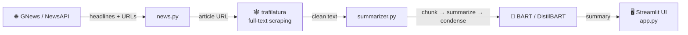

<div align="center">

# 📰 News Summarizer

### Read less. Know more.
Live headlines, condensed by an AI model running **locally**, with no paid LLM API.


**[🚀 Live Demo](https://news-summarizer-eybkbbvpbbx8y6ctpxdbpv.streamlit.app/)** · **[🐛 Report Bug](../../issues)** · **[💡 Request Feature](../../issues)**

<!-- Replace with a real screenshot or GIF: save it as assets/demo.png -->


</div>

---

## ✨ Features

| | |
|---|---|
| 🌍 **Live news** | Top headlines by category and country, or search any topic |
| 🧠 **Abstractive AI summaries** | Written by BART/DistilBART models that run on your own machine |
| 📄 **Full-article extraction** | Scrapes the real article text, because free news APIs only return snippets |
| 📚 **Long-article support** | Chunked two-pass summarization beats the model's token limit |
| ⚡ **Fast and frugal** | Cached model loading and API calls to save time and rate limits |
| 🔀 **Flexible** | Switch between GNews and NewsAPI, and between models |
| 🛡️ **Graceful fallback** | If a site blocks scraping, it summarizes the API snippet and warns you |
| 🔐 **Key-safe** | The server API key is never sent to the browser |

---

## 🏗️ How it works



1. **Fetch:** `news.py` calls the news API and normalizes both providers into one format.
2. **Extract:** `trafilatura` strips ads, menus and clutter to get the real article body.
3. **Summarize:** long text is split into chunks, each chunk is summarized, then the summaries are condensed again.
4. **Display:** Streamlit shows article cards with a one-click summary and a link to the original.

---

## 🧰 Tech Stack

- **Language:** Python 3.11
- **UI:** Streamlit
- **NLP:** Hugging Face Transformers, PyTorch (CPU)
- **Models:** `distilbart-cnn-6-6` (default), `distilbart-cnn-12-6`, optional `bart-large-cnn`
- **Data:** GNews API / NewsAPI
- **Scraping:** trafilatura
- **Config:** python-dotenv

---

## 🚀 Getting Started

### Prerequisites
- Python 3.10 or newer
- A free API key from [GNews](https://gnews.io) (100 requests/day, no card needed)

### Installation

```bash
# 1. Clone
git clone https://github.com/<your-username>/news-summarizer.git
cd news-summarizer

# 2. Create a virtual environment
python -m venv venv
source venv/bin/activate        # Windows: venv\Scripts\activate

# 3. Install dependencies
pip install -r requirements.txt

# 4. Add your API key
cp .env.example .env            # then edit .env

# 5. Run
streamlit run app.py
```

> The first run downloads the model (about 0.3 to 1.2 GB), so expect a short wait. After that it's cached.

### Configuration

| Variable | Description |
|---|---|
| `GNEWS_API_KEY` | Your GNews key |
| `NEWSAPI_KEY` | Your NewsAPI key (optional) |
| `ENABLE_LARGE_MODEL` | Set to `1` to unlock `bart-large-cnn` (needs about 3 GB+ RAM) |

---

## 📁 Project Structure

```
news-summarizer/
├── app.py            # Streamlit UI and app flow
├── news.py           # API clients and full-text extraction
├── summarizer.py     # Model loading, chunking, summarization
├── requirements.txt
├── .env.example      # Template for your API keys
└── README.md
```

---

## ☁️ Deployment

Deployed free on **Streamlit Community Cloud**:

1. Push this repo to GitHub.
2. At [share.streamlit.io](https://share.streamlit.io), choose the repo and set the main file to `app.py`.
3. Under **Advanced settings**, choose Python 3.11 and add your key in **Secrets**:
   ```toml
   GNEWS_API_KEY = "your_key"
   ```
4. Deploy.

The free tier has limited memory, so use the lightweight models there.

---

## ⚠️ Limitations

- **Hallucination:** abstractive models can occasionally state something the source doesn't. Use **Read original** to verify.
- **English news only:** the models were fine-tuned on CNN/DailyMail.
- **Paywalls:** some sites block scraping. The app falls back to the API snippet.
- **Speed:** CPU inference takes a few seconds per article.
- **API limits:** free tiers cap daily requests.

---

## 🗺️ Roadmap

- [ ] Sentiment analysis for each article
- [ ] Daily digest that summarizes the top stories together
- [ ] Multi-language support
- [ ] Sentence-aware chunking
- [ ] ROUGE-based quality evaluation
- [ ] Save and export summaries (PDF / Markdown)

---

## 🤝 Contributing

Contributions are welcome. Fork the repo, create a feature branch, and open a pull request.

## 📄 License

Distributed under the MIT License.

<div align="center">

⭐ If you found this useful, please star the repo.

</div>
